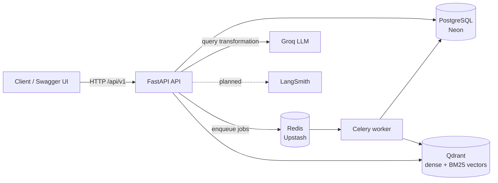
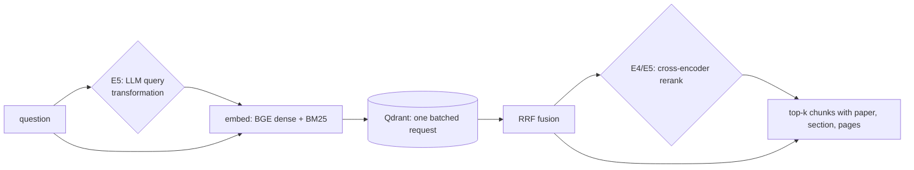
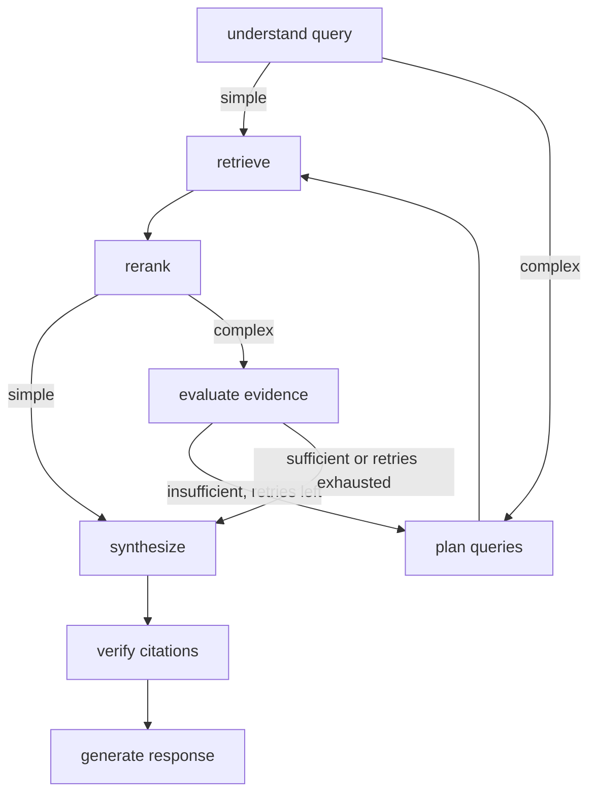

# ResearchPilot

**Intelligent research paper analysis: Advanced RAG and LangGraph orchestration.**

ResearchPilot ingests academic PDFs, indexes them for hybrid (semantic + keyword) search, and,
once the orchestration layer is complete, answers research questions with evidence-backed,
citation-verified analyses: factual answers, cross-paper comparisons, limitations, research gaps
and literature reviews.

The project focuses on backend engineering, retrieval quality, evaluation and observability
rather than on a UI. The FastAPI Swagger page is the interface.

> **Status:** work in progress. Ingestion (M2) and the retrieval engine (M3) are complete and
> verified against real cloud services. LangGraph orchestration, LangSmith tracing, evaluation
> and deployment are next. See the [roadmap](#roadmap) and
> [docs/DEVELOPMENT_PROGRESS.md](docs/DEVELOPMENT_PROGRESS.md). This README only describes what
> exists; planned parts are marked as such.

---

## Problem

Researchers reading many papers need to answer questions such as *"How do RAG-Sequence and
RAG-Token differ?"* or *"What limitations do these papers report?"* with answers they can
trust and verify. A basic "chat with your PDF" pipeline falls short:

* pure vector search misses exact technical terms, and pure keyword search misses paraphrases;
* chunks lose their provenance (paper, section, page), so claims cannot be verified;
* LLM answers can cite sources that do not support them, or invent them;
* without evaluation there is no evidence that any of it works.

ResearchPilot addresses these with structure-aware ingestion, hybrid retrieval with reranking,
an explicit multi-step research workflow, citation verification and measurable evaluation.

## Features

### Implemented

**Ingestion** ([docs](docs/ingestion_pipeline.md))
* Multi-file PDF upload with validation (extension, MIME, size, PDF signature, parseability,
  encryption, page limit) and duplicate detection by content hash.
* PyMuPDF extraction that keeps page numbers; font-based section heading detection; title,
  authors, year, DOI and arXiv ID extraction.
* Cleaning: ligatures, hyphenation, running headers/footers, page numbers.
* Structure-aware chunking: token-budgeted, never crosses sections, sentence overlap, page
  ranges, deterministic IDs (idempotent re-ingestion), references excluded by default.
* Dense (BGE) and sparse (BM25) vectors stored in Qdrant; metadata and job status in PostgreSQL.
* Background processing with Celery + Redis; retries with backoff for transient failures,
  compensating cleanup, consistent deletion across PostgreSQL, Qdrant and file storage.

**Retrieval** ([docs](docs/retrieval_engine.md))
* Dense, sparse and hybrid retrieval, fused with Reciprocal Rank Fusion.
* Cross-encoder reranking (BGE reranker).
* LLM query transformation: rewriting, multi-query expansion and decomposition, with validated
  structured output and graceful fallback.
* Five switchable strategies (E1–E5) for experiments, metadata filters (collection, paper,
  section, year), per-stage scores and timings.

**Platform**
* FastAPI with versioned routes, Pydantic schemas, one consistent error format, request IDs.
* Structured JSON logging with secret redaction.
* SQLAlchemy 2.0 + Alembic migrations on Neon serverless PostgreSQL.
* 187 automated tests that need no network, plus opt-in suites for real models, live LLM calls
  and PostgreSQL.

### Planned
* LangGraph research workflow: query understanding, planning, retrieval, reranking, evidence
  evaluation, synthesis, citation verification and response generation, with conditional
  routing, bounded retries and checkpointing (M4).
* Research endpoints with background execution and status tracking (M4).
* LangSmith tracing, evaluation datasets, Ragas and retrieval metrics, experiment reports (M5).
* Docker, Docker Compose and GitHub Actions CI (M6).

## Architecture





A **modular monolith**: one codebase run as two processes (API and worker) that share modules.

| Package | Responsibility |
|---|---|
| `app/core` | Settings, logging, errors, middleware, shared clients |
| `app/database` | SQLAlchemy models, sessions, repositories |
| `app/ingestion` | Validation, extraction, cleaning, chunking, pipeline |
| `app/embeddings` | Dense (BGE) and BM25 sparse encoders |
| `app/vectorstore` | Qdrant collection management |
| `app/retrieval` | Retrievers, fusion, reranking, query transformation, strategies |
| `app/llm` | Provider-neutral chat model factory |
| `app/services` | Use-case logic called by the API |
| `app/workers` | Celery app, tasks and dispatchers |
| `app/api` | Routes, schemas, dependencies |

More detail in [docs/architecture.md](docs/architecture.md), including the data model and design
decisions.

## Technology stack

| Area | Technology |
|---|---|
| Language / API | Python 3.10+, FastAPI, Pydantic v2, Uvicorn |
| Database | PostgreSQL ([Neon](https://neon.tech) serverless), SQLAlchemy 2.0, Alembic, psycopg 3 |
| Vector store | Qdrant (named dense + sparse vectors, IDF modifier) |
| Queue | Celery + Redis ([Upstash](https://upstash.com)) |
| PDF | PyMuPDF |
| Embeddings / reranking | Sentence Transformers: `BAAI/bge-small-en-v1.5`, `BAAI/bge-reranker-base` |
| LLM | LangChain + Groq (`openai/gpt-oss-120b`, `openai/gpt-oss-20b`) |
| Orchestration (planned) | LangGraph |
| Observability (planned) | LangSmith |
| Evaluation (planned) | Ragas, custom retrieval metrics |
| Quality | pytest, Ruff |

## Getting started

### Prerequisites
* Python 3.10 or newer
* Accounts on the free tiers of: Neon (PostgreSQL), Upstash (Redis), Qdrant Cloud, Groq
* About 2 GB of disk for the virtual environment and 1.3 GB for the models

### 1. Install

```bash
git clone https://github.com/<your-username>/researchpilot.git
cd researchpilot
python -m venv .venv
# Windows:  .venv\Scripts\activate      macOS/Linux:  source .venv/bin/activate

# CPU-only PyTorch first (much smaller than the default CUDA build)
pip install torch --index-url https://download.pytorch.org/whl/cpu
pip install -e ".[dev]"
# or reproduce the exact tested versions:
# pip install -r requirements/lock.txt && pip install -e . --no-deps
```

### 2. Configure

```bash
cp .env.example .env      # Windows: copy .env.example .env
```

Fill in `.env`:

| Variable | Where to get it |
|---|---|
| `DATABASE_URL` | Neon console → **Connect** → pooling **on** (host contains `-pooler`) |
| `DATABASE_URL_UNPOOLED` | Same, pooling **off** (used for migrations) |
| `REDIS_URL` | Upstash → database → Redis URL, as `rediss://default:<password>@<host>:6379` |
| `QDRANT_LOCATION`, `QDRANT_API_KEY` | Qdrant Cloud → cluster URL and API key |
| `GROQ_API_KEY` | console.groq.com → API Keys |

Without cloud accounts you can still run the API and tests locally: leave `DATABASE_URL` unset
(SQLite), use `QDRANT_LOCATION=./data/qdrant` (embedded mode, single process), and set
`TASK_BACKEND=inline` (ingestion in the API process, no Redis).

`.env.example` documents every setting (chunk sizes, retrieval candidates, upload limits and so on).

### 3. Create the database tables

```bash
alembic upgrade head
```

### 4. Run

```bash
# Terminal 1: API (http://127.0.0.1:8000/docs)
uvicorn app.main:app --reload

# Terminal 2: ingestion worker (on Windows --pool=solo is required)
celery -A app.workers.celery_app worker -Q ingestion --pool=solo --loglevel=INFO \
  --without-gossip --without-mingle --without-heartbeat
```

The first ingestion and the first reranked search download the models (~1.3 GB) into
`.cache/hf`.

## API

Interactive docs at `/docs` (Swagger) and `/redoc`.

| Method | Endpoint | Description |
|---|---|---|
| `GET` | `/api/v1/health` | Readiness: checks PostgreSQL, Redis and Qdrant (503 if any fails) |
| `GET` | `/api/v1/health/live` | Liveness |
| `POST` | `/api/v1/papers/upload` | Upload 1–10 PDFs (multipart), optional `collection`; returns 202 with a result per file |
| `GET` | `/api/v1/papers` | List papers (`limit`, `offset`, `status`, `collection`) |
| `GET` | `/api/v1/papers/{id}` | Paper metadata and ingestion history |
| `DELETE` | `/api/v1/papers/{id}` | Delete a paper, its vectors and its file |
| `POST` | `/api/v1/papers/{id}/reingest` | Re-run ingestion |
| `POST` | `/api/v1/retrieval/search` | Search with a chosen strategy (E1–E5) and filters |

Planned: `/api/v1/research/*` (M4) and `/api/v1/evaluations/*` (M5).

Example:

```bash
curl -X POST http://127.0.0.1:8000/api/v1/papers/upload \
  -F "files=@paper.pdf;type=application/pdf" -F "collection=rag-papers"

curl -X POST http://127.0.0.1:8000/api/v1/retrieval/search -H "Content-Type: application/json" \
  -d '{"query": "Compare RAG-Sequence and RAG-Token", "strategy": "hybrid_qt_rerank", "top_k": 5}'
```

Every error has the same shape and carries the request ID that also appears in the logs:

```json
{"error": {"code": "not_found", "message": "Paper not found", "details": {"paper_id": "..."}, "request_id": "..."}}
```

## Retrieval strategies (experiment configurations)

| Id | Strategy | Description |
|---|---|---|
| E1 | `dense` | BGE embedding similarity |
| E2 | `sparse` | BM25 keyword retrieval |
| E3 | `hybrid` | Dense + BM25, Reciprocal Rank Fusion |
| E4 | `hybrid_rerank` | E3 + cross-encoder reranking |
| E5 | `hybrid_qt_rerank` | E4 + LLM query rewriting / decomposition |

Compare them on your own papers:

```bash
python scripts/compare_retrieval.py "How did RAG perform on FEVER?" --top-k 3
```

## LangGraph workflow (planned, M4)

The research workflow will be a deterministic LangGraph state machine with LLM decisions only
where they help:



## Observability

Implemented: structured JSON logs with request IDs, per-stage timings for ingestion and
retrieval, and redaction of secrets (API keys, passwords, connection-string credentials).

Planned (M5): LangSmith traces of every graph run, node, LLM call and retrieval, with metadata
(request ID, strategy, model) and evaluation datasets. Tracing is optional, controlled by
`LANGSMITH_TRACING`, and off for tests.

## Evaluation (planned, M5)

* Retrieval metrics: Recall@K, Precision@K, MRR, nDCG, context precision/recall.
* Generation metrics (Ragas): faithfulness, answer relevancy, answer correctness.
* Citation validity, coverage and support accuracy; latency, token usage and cost.
* Experiments E1–E5 on a labelled question set, with results saved reproducibly.

### Experiment results

None yet. No evaluation has been run, so this README reports no scores. Early qualitative
observations (latency, reranker calibration, a known retrieval miss) are in
[docs/retrieval_engine.md](docs/retrieval_engine.md#findings-so-far).

## Testing

```bash
pytest                                  # 187 tests; no network or models needed
ruff check . && ruff format --check .

# Opt-in suites
RUN_MODEL_TESTS=1 pytest tests/integration/test_real_models.py    # real BGE models
RUN_LIVE_TESTS=1  pytest tests/integration/test_live_groq.py       # real Groq calls
TEST_DATABASE_URL=<neon direct url> pytest tests/integration/test_migrations.py
```

(On Windows use `set RUN_MODEL_TESTS=1 && pytest ...`.)

Regular tests use SQLite, in-memory Qdrant and deterministic fakes for the embedder, reranker,
LLM and task queue, so they never call paid APIs.

## Project structure

```
app/
  api/            routes, schemas, dependencies
  core/           config, logging, exceptions, middleware, shared resources, enums
  database/       models, session, repositories
  embeddings/     dense (BGE) and sparse (BM25) encoders
  ingestion/      validation, pdf_loader, text_cleaner, chunker, storage, pipeline
  llm/            chat model factory
  retrieval/      retrievers, fusion, reranker, query_transformer, engine
  services/       health, papers
  vectorstore/    Qdrant collection management
  workers/        Celery config, tasks, dispatchers
migrations/       Alembic
scripts/          compare_retrieval.py
tests/            unit/, integration/, fakes, PDF factory
docs/             architecture, ingestion, retrieval, progress log
```

## Known limitations

* No OCR: scanned PDFs are rejected at ingestion with a clear message.
* Equations are extracted as fragmented text and tables are flattened, so math-heavy chunks
  retrieve poorly.
* Heading detection is heuristic; authors come only from PDF metadata.
* Cross-encoder reranking takes ~7.5 s per query on a laptop CPU.
* Reranker scores are not calibrated probabilities.
* Uploaded PDFs are stored on local disk shared by the API and worker; multi-host deployment
  needs object storage.
* Developed and tested on Python 3.10 (Windows); 3.11+ is expected to work but has not been
  tested yet.

## Roadmap

| Milestone | Scope | Status |
|---|---|---|
| M1 | Foundation: config, logging, errors, DB models, migrations, health | ✅ |
| M2 | Ingestion pipeline, background worker, paper endpoints | ✅ |
| M3 | Retrieval engine: dense, sparse, hybrid, rerank, query transformation | ✅ |
| M4 | LangGraph orchestration, citation verification, research endpoints | ⏳ next |
| M5 | LangSmith tracing, evaluation framework, experiments E1–E5 | planned |
| M6 | Docker, Docker Compose, GitHub Actions CI | planned |
| M7 | Final documentation and validation | planned |

## Future improvements

* OCR fallback for scanned PDFs and better equation/table extraction.
* A faster reranker (smaller cross-encoder or ONNX) chosen from evaluation data.
* Object storage for uploaded files; authentication.
* Streaming research responses.

## License

MIT
