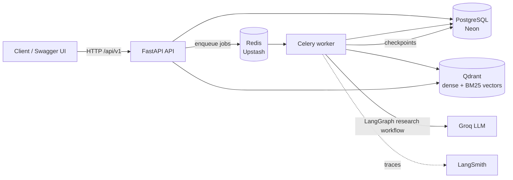
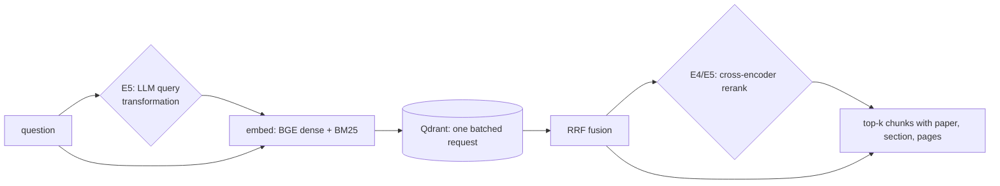
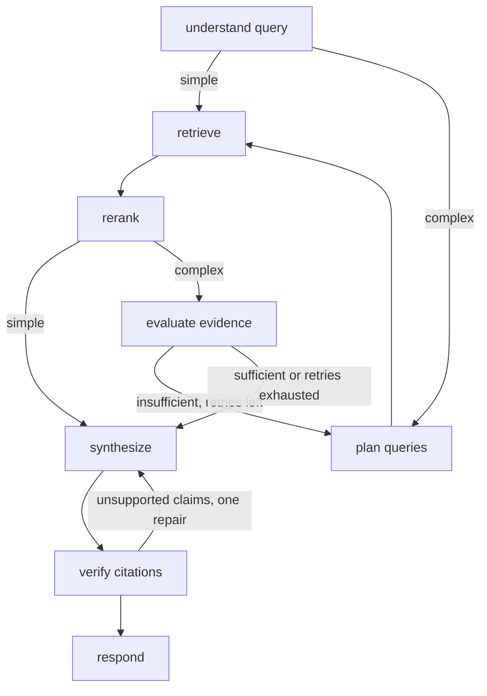

# ResearchPilot

**Intelligent research paper analysis: Advanced RAG and LangGraph orchestration.**

ResearchPilot ingests academic PDFs, indexes them for hybrid (semantic + keyword) search, and
answers research questions with evidence-backed, citation-verified analyses: factual answers,
cross-paper comparisons, limitations, research gaps and literature reviews.

The project focuses on backend engineering, retrieval quality, evaluation and observability
rather than on a UI. The FastAPI Swagger page is the interface.

> **Status:** work in progress. Ingestion (M2), retrieval (M3), the LangGraph research workflow
> (M4) and observability/evaluation (M5) are complete and verified against real cloud services.
> Containerisation and CI (M6) are next. See the [roadmap](#roadmap) and
> [docs/DEVELOPMENT_PROGRESS.md](docs/DEVELOPMENT_PROGRESS.md). This README only describes what
> exists; planned parts are marked as such.

---

## Problem

Researchers reading many papers need to answer questions such as *"How do RAG-Sequence and
RAG-Token differ?"* or *"What limitations do these papers report?"* with answers they can
trust and verify. A basic "chat with your PDF" pipeline falls short:

* pure vector search misses exact technical terms, and pure keyword search misses paraphrases;
* chunks lose their provenance (paper, section, page), so claims cannot be verified;
* LLM answers can cite sources that do not support them, or invent them;
* without evaluation there is no evidence that any of it works.

ResearchPilot addresses these with structure-aware ingestion, hybrid retrieval with reranking,
an explicit multi-step research workflow, citation verification and measurable evaluation.

## Features

### Implemented

**Ingestion** ([docs](docs/ingestion_pipeline.md))
* Multi-file PDF upload with validation (extension, MIME, size, PDF signature, parseability,
  encryption, page limit) and duplicate detection by content hash.
* PyMuPDF extraction that keeps page numbers; font-based section heading detection; title,
  authors, year, DOI and arXiv ID extraction.
* Cleaning: ligatures, hyphenation, running headers/footers, page numbers.
* Structure-aware chunking: token-budgeted, never crosses sections, sentence overlap, page
  ranges, deterministic IDs (idempotent re-ingestion), references excluded by default.
* Dense (BGE) and sparse (BM25) vectors stored in Qdrant; metadata and job status in PostgreSQL.
* Background processing with Celery + Redis; retries with backoff for transient failures,
  compensating cleanup, consistent deletion across PostgreSQL, Qdrant and file storage.

**Retrieval** ([docs](docs/retrieval_engine.md))
* Dense, sparse and hybrid retrieval, fused with Reciprocal Rank Fusion.
* Cross-encoder reranking (BGE reranker).
* LLM query transformation: rewriting, multi-query expansion and decomposition, with validated
  structured output and graceful fallback.
* Five switchable strategies (E1–E5) for experiments, metadata filters (collection, paper,
  section, year), per-stage scores and timings.

**Research workflow (LangGraph)** ([docs](docs/orchestration.md))
* Eight nodes: query understanding, planning, retrieval, reranking, evidence evaluation,
  synthesis, citation verification and response generation.
* Conditional routing by complexity, intent, evidence sufficiency and verification results;
  bounded retrieval retries and repair passes.
* Five analysis modes: factual, comparison, limitations (reported vs inferred), research gaps
  (hypotheses labelled, scoped to the collection) and literature review.
* Citation verification: fabricated IDs and uncited claims caught by code, support judged by an
  LLM, one repair pass, unsupported statements removed and listed.
* Durable checkpoints in PostgreSQL: resume after failure or worker crash without redoing work;
  optional human-in-the-loop pause before any node.
* Background execution with progress (`current_node`), per-node latency, token usage and
  verification metrics stored per request.
* Prompt-injection defences for retrieved text.

**Platform**
* FastAPI with versioned routes, Pydantic schemas, one consistent error format, request IDs.
* Structured JSON logging with secret redaction.
* SQLAlchemy 2.0 + Alembic migrations on Neon serverless PostgreSQL.
* 283 automated tests that need no network, plus opt-in suites for real models, live LLM calls
  and PostgreSQL.

### Planned
* Docker, Docker Compose and GitHub Actions CI (M6).

## Architecture





A **modular monolith**: one codebase run as two processes (API and worker) that share modules.

| Package | Responsibility |
|---|---|
| `app/core` | Settings, logging, errors, middleware, shared clients |
| `app/database` | SQLAlchemy models, sessions, repositories |
| `app/ingestion` | Validation, extraction, cleaning, chunking, pipeline |
| `app/embeddings` | Dense (BGE) and BM25 sparse encoders |
| `app/vectorstore` | Qdrant collection management |
| `app/retrieval` | Retrievers, fusion, reranking, query transformation, strategies |
| `app/llm` | Provider-neutral chat model factory |
| `app/orchestration` | LangGraph state, nodes, routing, prompts, checkpointing |
| `app/services` | Use-case logic called by the API |
| `app/workers` | Celery app, tasks and dispatchers |
| `app/api` | Routes, schemas, dependencies |

More detail in [docs/architecture.md](docs/architecture.md), including the data model and design
decisions.

## Technology stack

| Area | Technology |
|---|---|
| Language / API | Python 3.10+, FastAPI, Pydantic v2, Uvicorn |
| Database | PostgreSQL ([Neon](https://neon.tech) serverless), SQLAlchemy 2.0, Alembic, psycopg 3 |
| Vector store | Qdrant (named dense + sparse vectors, IDF modifier) |
| Queue | Celery + Redis ([Upstash](https://upstash.com)) |
| PDF | PyMuPDF |
| Embeddings / reranking | Sentence Transformers: `BAAI/bge-small-en-v1.5`, `BAAI/bge-reranker-base` |
| LLM | LangChain + Groq (`openai/gpt-oss-120b`, `openai/gpt-oss-20b`) |
| Orchestration | LangGraph (PostgreSQL checkpointer) |
| Observability | LangSmith (opt-in tracing, datasets, experiments) |
| Evaluation | Ragas 0.4, custom retrieval and citation metrics |
| Quality | pytest, Ruff |

## Getting started

### Prerequisites
* Python 3.10 or newer
* Accounts on the free tiers of: Neon (PostgreSQL), Upstash (Redis), Qdrant Cloud, Groq
* About 2 GB of disk for the virtual environment and 1.3 GB for the models

### 1. Install

```bash
git clone https://github.com/Nazir-Ahmed72/researchpilot.git
cd researchpilot
python -m venv .venv
# Windows:  .venv\Scripts\activate      macOS/Linux:  source .venv/bin/activate

# CPU-only PyTorch first (much smaller than the default CUDA build)
pip install torch --index-url https://download.pytorch.org/whl/cpu
pip install -e ".[dev]"
# or reproduce the exact tested versions:
# pip install -r requirements/lock.txt && pip install -e . --no-deps
```

### 2. Configure

```bash
cp .env.example .env      # Windows: copy .env.example .env
```

Fill in `.env`:

| Variable | Where to get it |
|---|---|
| `DATABASE_URL` | Neon console → **Connect** → pooling **on** (host contains `-pooler`) |
| `DATABASE_URL_UNPOOLED` | Same, pooling **off** (used for migrations) |
| `REDIS_URL` | Upstash → database → Redis URL, as `rediss://default:<password>@<host>:6379` |
| `QDRANT_LOCATION`, `QDRANT_API_KEY` | Qdrant Cloud → cluster URL and API key |
| `GROQ_API_KEY` | console.groq.com → API Keys |

Without cloud accounts you can still run the API and tests locally: leave `DATABASE_URL` unset
(SQLite), use `QDRANT_LOCATION=./data/qdrant` (embedded mode, single process), and set
`TASK_BACKEND=inline` (ingestion in the API process, no Redis).

`.env.example` documents every setting (chunk sizes, retrieval candidates, upload limits and so on).

### 3. Create the database tables

```bash
alembic upgrade head
```

### 4. Run

```bash
# Terminal 1: API (http://127.0.0.1:8000/docs)
uvicorn app.main:app --reload

# Terminal 2: worker for ingestion and research (on Windows --pool=solo is required)
celery -A app.workers.celery_app worker -Q ingestion,research --pool=solo --loglevel=INFO \
  --without-gossip --without-mingle --without-heartbeat
```

The first ingestion and the first reranked search download the models (~1.3 GB) into
`.cache/hf`.

## API

Interactive docs at `/docs` (Swagger) and `/redoc`.

| Method | Endpoint | Description |
|---|---|---|
| `GET` | `/api/v1/health` | Readiness: checks PostgreSQL, Redis and Qdrant (503 if any fails) |
| `GET` | `/api/v1/health/live` | Liveness |
| `POST` | `/api/v1/papers/upload` | Upload 1–10 PDFs (multipart), optional `collection`; returns 202 with a result per file |
| `GET` | `/api/v1/papers` | List papers (`limit`, `offset`, `status`, `collection`) |
| `GET` | `/api/v1/papers/{id}` | Paper metadata and ingestion history |
| `DELETE` | `/api/v1/papers/{id}` | Delete a paper, its vectors and its file |
| `POST` | `/api/v1/papers/{id}/reingest` | Re-run ingestion |
| `POST` | `/api/v1/retrieval/search` | Search with a chosen strategy (E1–E5) and filters |
| `POST` | `/api/v1/research/query` | Ask a research question; returns 202 and a status URL |
| `GET` | `/api/v1/research/{id}` | Status, live progress (`current_node`) and the verified answer |
| `POST` | `/api/v1/research/{id}/resume` | Resume a failed or paused run from its checkpoint |
| `POST` | `/api/v1/evaluations/run` | Run retrieval experiments E1–E5 and/or the end-to-end evaluation in the background |
| `GET` | `/api/v1/evaluations/results` | Evaluation runs with their metrics (`?experiment=E4`) |
| `GET` | `/api/v1/evaluations/results/{id}` | One evaluation run |

Example:

```bash
curl -X POST http://127.0.0.1:8000/api/v1/papers/upload \
  -F "files=@paper.pdf;type=application/pdf" -F "collection=rag-papers"

curl -X POST http://127.0.0.1:8000/api/v1/retrieval/search -H "Content-Type: application/json" \
  -d '{"query": "Compare RAG-Sequence and RAG-Token", "strategy": "hybrid_qt_rerank", "top_k": 5}'

curl -X POST http://127.0.0.1:8000/api/v1/research/query -H "Content-Type: application/json" \
  -d '{"question": "Compare traditional RAG and GraphRAG approaches", "collection": "rag-papers"}'
# -> {"request_id": "...", "status": "queued", "status_url": "/api/v1/research/..."}
curl http://127.0.0.1:8000/api/v1/research/<request_id>
```

Every error has the same shape and carries the request ID that also appears in the logs:

```json
{"error": {"code": "not_found", "message": "Paper not found", "details": {"paper_id": "..."}, "request_id": "..."}}
```

## Retrieval strategies (experiment configurations)

| Id | Strategy | Description |
|---|---|---|
| E1 | `dense` | BGE embedding similarity |
| E2 | `sparse` | BM25 keyword retrieval |
| E3 | `hybrid` | Dense + BM25, Reciprocal Rank Fusion |
| E4 | `hybrid_rerank` | E3 + cross-encoder reranking |
| E5 | `hybrid_qt_rerank` | E4 + LLM query rewriting / decomposition |

Compare them on your own papers:

```bash
python scripts/compare_retrieval.py "How did RAG perform on FEVER?" --top-k 3
```

## LangGraph workflow



Example output (live run, abridged):

```markdown
## Answer
Self-RAG highlights that standard retrieval-augmented generation suffers from indiscriminate
fixed-size retrieval, irrelevant passages, ... and insufficient attribution.

## Reported limitations
- Standard RAG retrieves a fixed number of passages indiscriminately, even when retrieval is
  unnecessary or passages are irrelevant ... [1][2][3]

## Additional observations
- *Inferred:* These limitations suggest a need for adaptive, on-demand retrieval ... [2][3]

## References
[1] SELF-RAG: ... (2023), ABSTRACT, p. 1
[2] SELF-RAG: ... (2023), 1 INTRODUCTION, p. 1
```

Routing rules, failure handling and live measurements are in
[docs/orchestration.md](docs/orchestration.md).

## Observability

* **Structured JSON logs** with request IDs, per-stage timings, and redaction of credentials
  (API keys, passwords, connection-string credentials); token counters are kept.
* **Per-request metrics** for every research run: end-to-end and per-node latency, retries,
  repairs, token usage per model, optional cost, errors and a compact node trace.
* **LangSmith tracing (opt-in, `LANGSMITH_TRACING=true`)**: the whole LangGraph run, every node,
  every LLM call (prompt, structured output, tokens, latency), and named `hybrid_search` /
  `cross_encoder_rerank` steps with chunk ids and scores; tagged with request id, strategy,
  collection, models and app version. Inputs and outputs are redacted before upload. Tests never
  trace.
* **LangSmith datasets and experiments**: the evaluation set and one experiment per retrieval
  strategy, for side-by-side comparison.

Details: [docs/observability.md](docs/observability.md).

## Evaluation

A labelled dataset of 20 questions over the four papers (simple factual, comparison,
multi-document, limitations, multi-query and **unanswerable** questions). Evidence is labelled
by content ("this paper, containing these phrases"), validated against the indexed chunks before
every run, and robust to re-chunking. Retrieval is evaluated separately from generation.

* **Retrieval:** Recall@K, Precision@K, MRR, nDCG@K and latency for strategies E1–E5.
* **End to end:** completion, abstention accuracy, false abstention, evidence recall, citation
  label accuracy (no LLM involved), citation validity/coverage, LLM-judged support rate,
  latency (total and per node), tokens and cost per query.
* **Ragas** (faithfulness, answer relevancy, answer correctness, context recall) with Groq as the
  judge, on saved answers.
* Results are written to `experiments/results/<timestamp>_<name>/` (config with code version,
  per-question JSONL, summary, Markdown report) and can be published to LangSmith as a dataset
  with one experiment per strategy.

### Experiment results (single run, 17 answerable questions, top-K 5)

| Exp | Strategy | Recall@5 | Precision@5 | MRR | nDCG@5 | Latency |
|---|---|---|---|---|---|---|
| E1 | dense | 0.490 | 0.129 | 0.345 | 0.354 | 0.25 s |
| E2 | sparse (BM25) | 0.471 | 0.118 | 0.379 | 0.364 | 0.18 s |
| E3 | hybrid (RRF) | 0.578 | 0.153 | 0.458 | 0.431 | 0.24 s |
| E4 | hybrid + rerank | 0.588 | 0.165 | 0.456 | 0.461 | 10.0 s |
| E5 | hybrid + query transformation + rerank | 0.588 | 0.165 | 0.456 | 0.461 | 10.3 s |

End-to-end workflow (E4): abstention accuracy 1.00, false abstention 0.00, citation validity
1.00, LLM-judged support rate 0.97, but **evidence recall 0.50 and citation label accuracy
0.30**. Answers are faithful to what they cite, but often cite general overview passages rather
than the most specific evidence. Median latency 13.5 s, ~7.2k tokens per query.

Takeaways: hybrid retrieval clearly beats dense or sparse alone; reranking adds little at top-5
on CPU and hurts multi-part questions; query transformation made no measurable difference on
this set. These are directional results from a small dataset. Full tables, per-category results,
caveats (including LLM-as-a-judge limitations) and next steps are in
[docs/evaluation.md](docs/evaluation.md).

## Testing

```bash
pytest                                  # 283 tests; no network or models needed
ruff check . && ruff format --check .

# Opt-in suites
RUN_MODEL_TESTS=1 pytest tests/integration/test_real_models.py    # real BGE models
RUN_LIVE_TESTS=1  pytest tests/integration/test_live_groq.py       # real Groq calls
RUN_LIVE_TESTS=1  pytest tests/integration/test_live_checkpoint.py # Neon checkpoint resume
# Destructive (drops all tables); refuses to run unless the database is EMPTY:
TEST_DATABASE_URL=<direct url of an empty Neon branch> pytest tests/integration/test_migrations.py
```

(On Windows use `set RUN_MODEL_TESTS=1 && pytest ...`.)

Regular tests use SQLite, in-memory Qdrant and deterministic fakes for the embedder, reranker,
LLM and task queue, so they never call paid APIs.

## Project structure

```
app/
  api/            routes, schemas, dependencies
  core/           config, logging, exceptions, middleware, shared resources, enums
  database/       models, session, repositories
  embeddings/     dense (BGE) and sparse (BM25) encoders
  ingestion/      validation, pdf_loader, text_cleaner, chunker, storage, pipeline
  llm/            chat model factory
  orchestration/  LangGraph state, nodes/, routing, prompts, schemas, checkpoint, graph
  retrieval/      retrievers, fusion, reranker, query_transformer, engine
  services/       health, papers, research
  vectorstore/    Qdrant collection management
  evaluation/     dataset + labels, metrics, retrieval/generation/Ragas evaluation, reports
  observability/  LangSmith tracing
  workers/        Celery config, tasks, dispatchers
migrations/       Alembic
scripts/          compare_retrieval.py, run_evaluation.py
experiments/      results/ of evaluation runs (reports, per-question data)
tests/            unit/, integration/, fakes, PDF factory
docs/             architecture, ingestion, retrieval, orchestration, observability, evaluation, progress
```

## Known limitations

* No OCR: scanned PDFs are rejected at ingestion with a clear message.
* Equations are extracted as fragmented text and tables are flattened, so math-heavy chunks
  retrieve poorly.
* Heading detection is heuristic; authors come only from PDF metadata.
* Cross-encoder reranking takes ~7.5 s per query on a laptop CPU; a research run takes
  20–90 s.
* Groq's free tier allows `gpt-oss-120b` only 8k tokens/minute, so back-to-back research runs
  are throttled.
* Multi-hop questions phrased as one sentence can be classified "simple" and skip the
  evidence-evaluation step.
* No streaming; poll `GET /research/{id}` for progress.
* Reranker scores are not calibrated probabilities.
* Uploaded PDFs are stored on local disk shared by the API and worker; multi-host deployment
  needs object storage.
* Developed and tested on Python 3.10 (Windows); 3.11+ is expected to work but has not been
  tested yet.

## Roadmap

| Milestone | Scope | Status |
|---|---|---|
| M1 | Foundation: config, logging, errors, DB models, migrations, health | ✅ |
| M2 | Ingestion pipeline, background worker, paper endpoints | ✅ |
| M3 | Retrieval engine: dense, sparse, hybrid, rerank, query transformation | ✅ |
| M4 | LangGraph orchestration, citation verification, research endpoints | ✅ |
| M5 | LangSmith tracing, evaluation framework, experiments E1–E5 | ✅ |
| M6 | Docker, Docker Compose, GitHub Actions CI | ⏳ next |
| M7 | Final documentation and validation | planned |

## Future improvements

* OCR fallback for scanned PDFs and better equation/table extraction.
* A faster reranker (smaller cross-encoder or ONNX) chosen from evaluation data.
* Object storage for uploaded files; authentication.
* Streaming research responses.

## License

MIT
