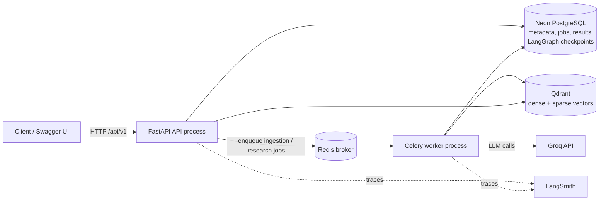
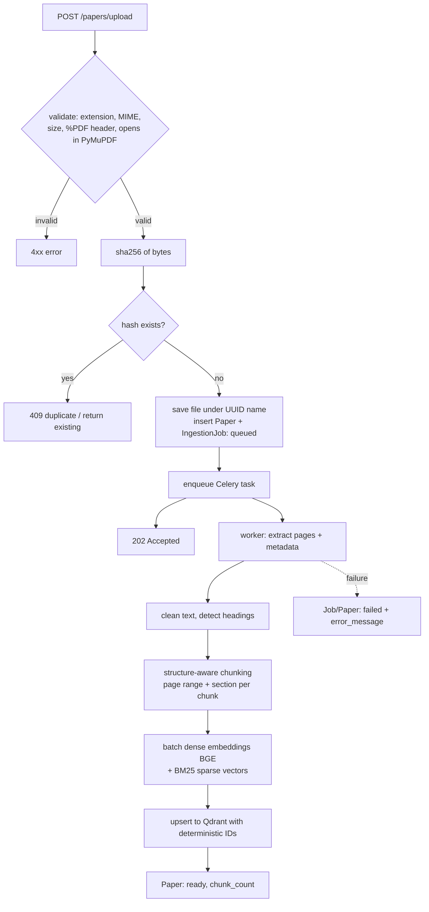
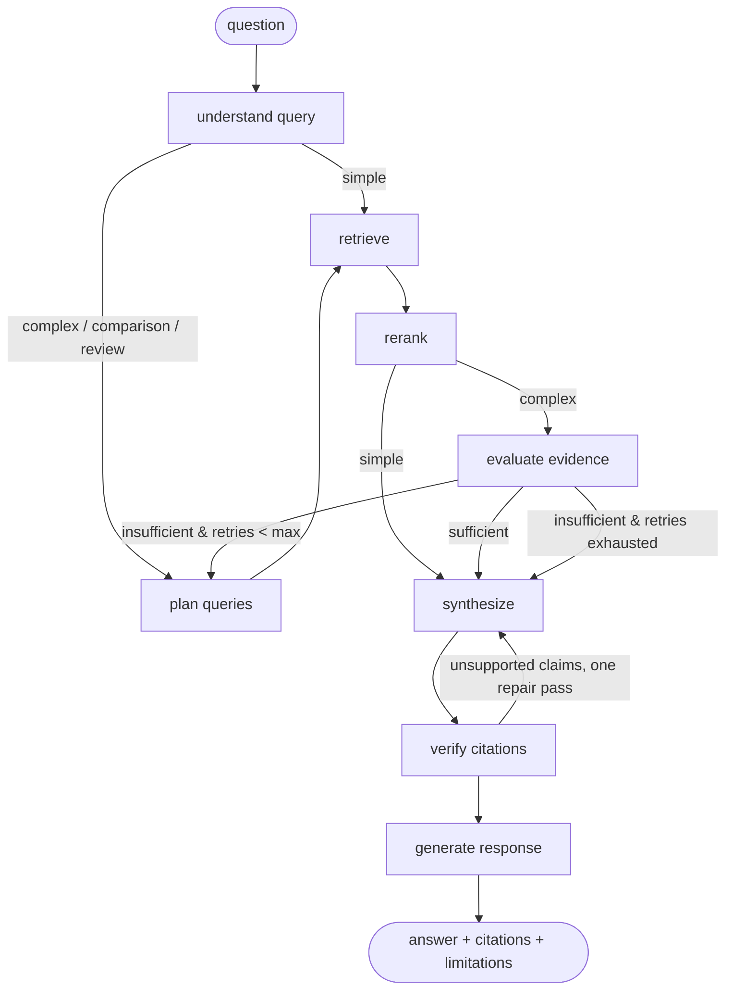
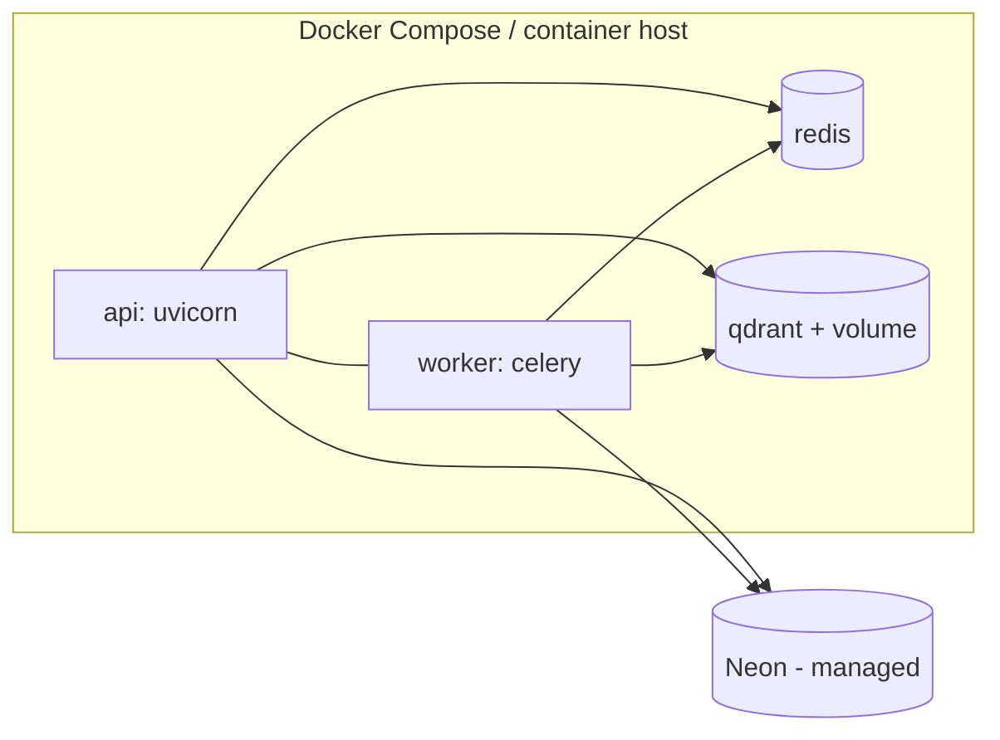

# ResearchPilot — Architecture

Status: implemented (M1–M6). Each section links to the detailed document for its module;
measured behaviour and known limitations are in those documents and in
[DEVELOPMENT_PROGRESS.md](DEVELOPMENT_PROGRESS.md).

## 1. Goals and shape

ResearchPilot answers research questions over a collection of uploaded papers with
evidence-backed, citation-verified answers. It is a **modular monolith**: one Python codebase,
deployed as two processes (API and background worker) sharing the same modules. Microservices
would add network hops and deployment overhead without any scaling need at this size.



## 2. Module responsibilities

| Package | Responsibility | Depends on |
|---|---|---|
| `app/core` | Settings, logging, exceptions, middleware, shared clients (`Resources`) | — |
| `app/database` | ORM models, sessions, repositories | `core` |
| `app/ingestion` | PDF validation → extraction → cleaning → chunking → pipeline orchestration ([details](ingestion_pipeline.md)) | `core`, `database`, `embeddings`, `vectorstore` |
| `app/embeddings` | Dense (BGE via Sentence Transformers) and BM25 sparse encoders, shared by ingestion and retrieval | — |
| `app/vectorstore` | Qdrant collection setup, upsert, delete-by-paper | `embeddings` |
| `app/retrieval` | Dense, sparse, hybrid (RRF), reranking, query transformation, strategies E1–E5 ([details](retrieval_engine.md)) | `core`, `embeddings`, `llm` |
| `app/llm` | Provider-neutral chat model factory (Groq: `gpt-oss-120b` main, `gpt-oss-20b` fast) | `core` |
| `app/orchestration` | LangGraph state, nodes, routing, checkpointing ([details](orchestration.md)) | `retrieval`, `llm` |
| `app/evaluation` | Labelled dataset, retrieval/citation metrics, Ragas, experiments E1–E5, reports ([details](evaluation.md)) | `retrieval`, `orchestration` |
| `app/observability` | LangSmith tracer with redaction, client for datasets/experiments ([details](observability.md)) | `core` |
| `app/services` | Use-case logic called by routes and workers | all of the above |
| `app/api` | HTTP routes, request/response schemas, dependency injection | `services` |
| `app/workers` | Celery app/config, task entry points, dispatchers (Celery or in-process) | `ingestion` |

Rules: ingestion never imports orchestration (and vice versa); routes contain no business logic;
infrastructure clients are injected (via `Resources` / FastAPI dependencies), not imported as
globals, so every component can be tested with in-memory substitutes.

## 3. Key decisions

| Decision | Choice | Why |
|---|---|---|
| Database | **Neon** serverless PostgreSQL | Managed Postgres, no local container needed; branching gives disposable test databases. |
| Neon connections | Pooled URL for app, direct URL for Alembic | PgBouncer transaction mode breaks migrations/session state. Pooled connections disable psycopg prepared statements. |
| Scale-to-zero | `pool_pre_ping` + `pool_recycle=240s` | Neon closes idle connections after suspend (5 min default). |
| DB access | Synchronous SQLAlchemy 2.0 + psycopg 3 | Celery worker is sync; FastAPI runs `def` routes in a thread pool. One data-access style instead of two. |
| Enums in DB | Strings (`native_enum=False`) | Adding a status is a code change, not an `ALTER TYPE` migration; portable to SQLite tests. |
| JSON columns | JSONB on Postgres, JSON on SQLite | Queryable on Postgres, still testable without a server. |
| IDs | UUIDv4 rows; chunk IDs = `uuid5(sha256(pdf), chunk index)` | Re-ingesting the same file is idempotent (upsert, not duplicate). |
| Vectors | Qdrant only (not pgvector) | Native named dense + sparse vectors and server-side hybrid queries. |
| Hosting without Docker | Upstash Redis + Qdrant Cloud (free tiers) | Real API + separate worker architecture; Qdrant's embedded mode can't be shared by two processes. |
| Sparse vectors | Own BM25 encoder (stemmed, CRC32 term ids) + Qdrant IDF modifier | No extra model runtime; deterministic; documents never need re-encoding when the corpus grows. |
| Chunk size | 350 tokens, 50 overlap, plus a title/section header | BGE-small reads 512 tokens max; the header must fit too. |
| LLM | Groq behind a factory: `openai/gpt-oss-120b` (main), `openai/gpt-oss-20b` (fast) | Llama 3.3 70B was retired on Groq; two tiers keep frequent small calls cheap. Provider and models are settings. |
| Fusion | Reciprocal Rank Fusion (own implementation) | Dense and BM25 scores are on incomparable scales; RRF uses ranks only. |
| Reranker | bge-reranker-base, top 10 candidates | Spec choice; 10 candidates keeps CPU latency ~7.5 s. Smaller/ONNX options to be evaluated in M5. |
| Logging | stdlib `logging` + JSON formatter, request ID via `contextvars`, secret redaction | No extra dependency; correlates every log line to a request. |
| Errors | One `ErrorResponse` schema; unexpected errors handled in middleware | Clients parse one shape; 500s never leak internals but always carry the request ID. |
| Health | `/health/live` (process) vs `/health` (dependencies, 503 when degraded) | Orchestrators restart on liveness, route traffic on readiness. Checks run in parallel with timeouts. |

## 4. Data model

```mermaid
erDiagram
    PAPER_COLLECTIONS ||--o{ PAPERS : contains
    PAPERS ||--o{ INGESTION_JOBS : "processed by"
    PAPER_COLLECTIONS ||--o{ RESEARCH_REQUESTS : "scoped to"
    RESEARCH_REQUESTS ||--o| RESEARCH_RESULTS : produces

    PAPER_COLLECTIONS { uuid id PK; string name UK; text description }
    PAPERS {
        uuid id PK; uuid collection_id FK; string content_hash UK; string original_filename
        string storage_path; bigint file_size_bytes; text title; json authors
        int publication_year; string doi; int page_count; int chunk_count
        json pdf_metadata; string status; text error_message
    }
    INGESTION_JOBS {
        uuid id PK; uuid paper_id FK; string status; string task_id; int attempts
        json stats; text error_message; timestamp started_at; timestamp finished_at
    }
    RESEARCH_REQUESTS {
        uuid id PK; uuid collection_id FK; text question; string analysis_type
        string retrieval_strategy; string status; string thread_id; json options
    }
    RESEARCH_RESULTS {
        uuid id PK; uuid request_id FK,UK; text answer; json findings; json citations
        bool evidence_sufficient; json verification; json metrics
    }
    EVALUATION_RUNS {
        uuid id PK; string name; string experiment; string retrieval_strategy
        string dataset_name; string status; json config; json metrics; string results_path
    }
```

All tables have `created_at` / `updated_at`. Deleting a paper cascades to its jobs; deleting a
collection keeps its papers (`SET NULL`). Postgres ↔ Qdrant consistency on delete: mark
paper `deleting` → delete vectors by `paper_id` filter → delete row; a failed vector delete leaves
the row in `deleting` so it can be retried rather than orphaning vectors.

## 5. Ingestion workflow

Implemented; see [ingestion_pipeline.md](ingestion_pipeline.md) for details.



## 6. Research workflow (LangGraph)

Implemented; see [orchestration.md](orchestration.md) for details.



State holds IDs, scores and short text snippets only (no PDF bytes). Retries are bounded by a
setting; when evidence stays insufficient the answer says so explicitly. Checkpoints are stored
in Neon via the LangGraph Postgres checkpointer (direct connection).

## 7. Deployment

Implemented; see [deployment.md](deployment.md) for the image, Compose stack, CI and cloud notes.



PostgreSQL is not part of the default Compose stack because Neon is managed (an optional
`local-db` profile adds a PostgreSQL container for offline use). Qdrant and Redis run in Compose,
or are swapped for managed equivalents via `QDRANT_LOCATION` / `REDIS_URL`.

## 8. Security

* Uploads: size limit, extension + MIME + magic-byte checks, stored under generated UUID names
  (no user-controlled paths), never executed.
* Secrets: `SecretStr` settings, redaction in logs, health errors expose exception types only.
* Prompt injection: retrieved text is wrapped in `<evidence>` blocks with tag-like content
  neutralised, every system prompt states that evidence is untrusted data, questions are
  delimited and treated as data, outputs are schema-validated, and citations are checked against
  the actual evidence IDs (see [orchestration.md](orchestration.md)).
* Request IDs from clients are accepted only if they match `[A-Za-z0-9._-]{1,128}`.
