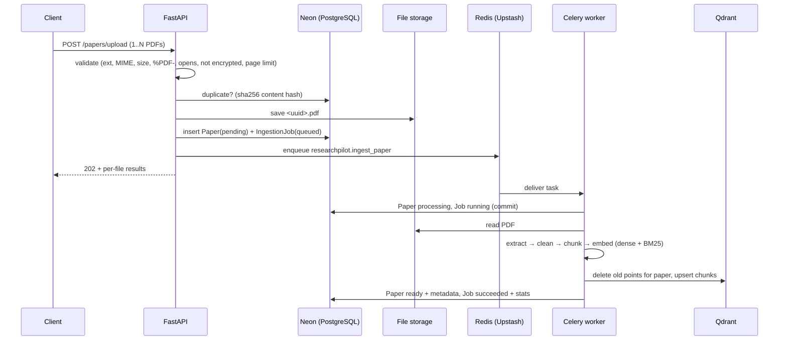

# Ingestion Pipeline

Turns uploaded PDFs into searchable chunks with full provenance. Implemented in M2.



## Stages

| Stage | Module | What it does |
|---|---|---|
| Validation | `app/ingestion/validation.py` | `.pdf` extension, declared MIME not obviously wrong, size ≤ `MAX_UPLOAD_SIZE_MB`, `%PDF-` signature, PyMuPDF can open it, not encrypted, 1 to `MAX_PDF_PAGES` pages. Filenames are sanitised and kept only as metadata. |
| Extraction | `app/ingestion/pdf_loader.py` | PyMuPDF `get_text("dict")` per page, in content-stream order (geometric sorting would interleave two-column layouts). Keeps page number, font size, boldness, position. Skips rotated text. |
| Structure | `pdf_loader.py` | Body font = most common size. A line is a heading if short and styled (bold or ≥1.15× body) and numbered or a known section name, or ≥1.3× body. Separate number lines (`2.1` + `Models`) are glued; wrapped headings are merged; the largest text at the top of page 1 is the title. |
| Metadata | `pdf_loader.py` | Title (PDF metadata unless junk, else page-1 title), authors (PDF metadata), DOI (regex), arXiv ID (incl. rotated margin stamp), year (arXiv ID, else PDF creation date). |
| Cleaning | `app/ingestion/text_cleaner.py` | NFKC (splits ligatures `fi`), removes control/zero-width chars, re-joins hyphenated line breaks, drops margin text repeated on ≥ half the pages and bare page numbers. |
| Chunking | `app/ingestion/chunker.py` | Sections at headings; paragraphs packed up to `CHUNK_SIZE_TOKENS` (real tokenizer); long paragraphs split by sentence, then word windows; `CHUNK_OVERLAP_TOKENS` of trailing sentences repeated; never crosses sections; References skipped unless `INDEX_REFERENCES=true`. |
| Embedding | `app/embeddings/dense.py`, `sparse.py` | Dense: BGE-small (384-d, normalised) on `"title | section\ntext"`. Sparse: BM25 term-frequency weights over stemmed, stop-word-filtered tokens hashed with CRC32; Qdrant applies IDF. |
| Indexing | `app/vectorstore/qdrant_store.py` | One collection, named vectors `dense` (cosine) + `bm25` (IDF modifier); payload indexes on `paper_id`, `collection_id`, `section`, `year`, `page_start`. |

### Chunk payload (provenance)

`chunk_id`, `chunk_index`, `paper_id`, `collection_id`, `text`, `section`, `page_start`,
`page_end`, `token_count`, `title`, `authors`, `year`, `doi`, `source` (original filename).

## Reliability

* **Idempotent.** Chunk ID = `uuid5(sha256(pdf), chunk_index)`. Before upserting, existing points
  for the paper are deleted, so retries and re-ingestion never duplicate vectors.
* **Errors are classified.** `PermanentIngestionError` (no text, corrupt PDF) fails immediately.
  Anything else is transient: the worker retries with exponential backoff up to
  `INGESTION_MAX_RETRIES`, and between attempts the paper is `pending` and the job `queued`.
* **Compensation.** If indexing fails, vectors written so far are deleted. If the paper was
  deleted while ingestion ran, the worker deletes the vectors it just wrote.
* **Short transactions.** No database transaction is held open during embedding.
* **Worker crashes.** `acks_late` + `reject_on_worker_lost`: the task is redelivered and
  re-runs safely.
* **Secrets.** Error messages stored on the job are redacted.

## Delete consistency

`DELETE /papers/{id}`: paper → `deleting` (commit) → delete Qdrant points → delete file → delete
row. If Qdrant is unavailable the API returns 503 and the paper stays `deleting`; repeating the
delete finishes the job. Deleting a paper that is `processing` returns 409.

## Running the worker

```bash
# Windows needs the solo pool; on Linux/Docker use the default prefork pool.
celery -A app.workers.celery_app worker -Q ingestion --pool=solo --loglevel=INFO \
    --without-gossip --without-mingle --without-heartbeat
```

Without Redis, set `TASK_BACKEND=inline` to ingest in a background thread of the API process.

### Redis traffic (Upstash free tier)

Kombu's default makes an idle worker poll Redis every second (~2.6 M commands/month). We set
`polling_interval=10` (blocking `BRPOP` timeout; new tasks still arrive immediately),
`health_check_interval=60`, no result backend, no remote control, no events, and the `--without-*`
flags.

## Measured on a real paper

arXiv 2005.11401 (RAG, 19 pages) on a CPU laptop, Neon + Upstash + Qdrant Cloud:

| Metric | Value |
|---|---|
| Headings detected | 25 (all numbered sections and subsections) |
| Chunks | 43 (79 to 350 tokens, mean 250) |
| Extract / chunk / embed / index | 0.3 s / 0.08 s / 6.9 s / 3.8 s |
| Upload → `ready` | ~12 s |

## Known limitations

* No OCR: scanned (image-only) PDFs fail with "No extractable text".
* Equations come out as fragmented glyphs; tables are flattened to text.
* Appendix headings with a lone letter (`A`) are not detected (too many false positives).
* Authors come only from PDF metadata; many arXiv PDFs leave it empty.
* Heading detection is heuristic. Unusual templates may produce coarse sections; chunks
  are still created, only with less precise section labels.
* Stored PDFs live on local disk shared by API and worker; a multi-host deployment needs object
  storage (same three-method interface as `LocalFileStorage`).
