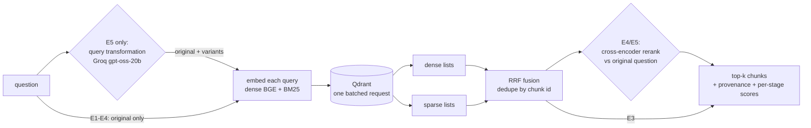

# Retrieval Engine

Finds the evidence chunks for a question. Implemented in M3. Each component is usable and
testable on its own; `RetrievalEngine` composes them into the five experiment strategies.



## Strategies

| Id | `strategy` | Queries | Retrieval | Rerank |
|---|---|---|---|---|
| E1 | `dense` | original | BGE embeddings (cosine) | no |
| E2 | `sparse` | original | BM25 (Qdrant IDF) | no |
| E3 | `hybrid` | original | dense + BM25, RRF | no |
| E4 | `hybrid_rerank` | original | dense + BM25, RRF | yes |
| E5 | `hybrid_qt_rerank` | original + LLM variants | dense + BM25 per variant, RRF over all lists | yes |

## Components

| Module | Responsibility |
|---|---|
| `retrieval/qdrant_search.py` | Builds filters (collection, papers, sections, year range) and sends all searches of a request in **one** `query_batch_points` call. Returns `[]` if nothing has been indexed yet. |
| `retrieval/retrievers.py` | `DenseRetriever`, `SparseRetriever`, `HybridRetriever`. A stop-word-only sparse query is skipped. |
| `retrieval/fusion.py` | Reciprocal Rank Fusion, `k=60`, optional per-list weights; each list votes once per chunk; deterministic tie-break; keeps every stage's scores/ranks. |
| `retrieval/reranker.py` | `CrossEncoderReranker` (bge-reranker-base), loaded once per process; `rerank()` reorders and truncates while preserving metadata. |
| `retrieval/query_transformer.py` | One structured LLM call → `QueryPlan` (complexity, rewrite, alternatives, sub-questions); validated, de-duplicated, capped; falls back to the original question on any failure. |
| `retrieval/engine.py` | Runs a strategy; records per-stage timings; logs strategy, query count and returned chunk IDs. |
| `llm/factory.py` | Provider-neutral chat model creation (Groq today). |

### Why RRF instead of score normalisation
Dense cosine scores (≈0.6–0.8 here) and BM25 scores (≈1–9 here) are on unrelated scales, and
min-max normalisation is fragile to outliers. RRF only uses ranks, needs one standard constant,
and naturally rewards chunks that several retrievers or query variants agree on.

### Query transformation rules
* Simple questions: original + one rewrite. No multi-query or decomposition.
* Complex questions (comparisons, multi-part, surveys): original, rewrite, up to 4 sub-questions
  and up to 3 alternatives, capped at `MAX_QUERY_VARIANTS` (default 4) in that priority order.
* Every query is whitespace-normalised and must have ≥3 letters/digits and ≤300 characters;
  case-insensitive duplicates are removed; the original is always searched first.
* The prompt forbids answering and adding facts; the user's text is delimited and treated only as
  a question. Live test: an "ignore previous instructions" input was simply turned into a query.
* Reranking always scores against the **original** question.

## API

`POST /api/v1/retrieval/search`

```json
{"query": "Compare RAG-Sequence and RAG-Token", "strategy": "hybrid_qt_rerank", "top_k": 5,
 "collection": "rag-papers", "paper_ids": [], "sections": [], "year_from": 2019, "year_to": 2024}
```

The response contains the queries actually searched, the transformation details, per-stage
timings, and per result: chunk/paper IDs, title, section, page range, text, and every stage's
score and rank.

Side-by-side comparison on live data:

```bash
python scripts/compare_retrieval.py "What retriever does RAG use?" "Compare RAG-Sequence and RAG-Token"
```

## Measured behaviour (one paper, 43 chunks, Qdrant Cloud in Seoul, 8-core laptop CPU)

| Step | Latency |
|---|---|
| Query transformation (Groq gpt-oss-20b) | 0.8–1.4 s |
| Sparse search | ~0.2–0.3 s |
| Dense / hybrid search (incl. query embedding, 1 round trip) | ~0.25–1.1 s |
| Rerank, 10 candidates / 20 candidates | ~7.5 s / ~12.8 s |

These are single observations for orientation, **not** an evaluation. Quality comparison of
E1–E5 requires the labelled evaluation set (M5).

## Findings so far

* **Reranker scores are not calibrated probabilities.** On BGE's reference pair the relevant
  passage scores 0.998 vs 0.0003, but a relevant passage that never names the query's subject
  ("based on DPR" for "What retriever does RAG use?") scored 0.007. Ordering is reliable;
  absolute thresholds must be calibrated (relevant for M4's evidence-sufficiency check).
* **Single-topic corpora weaken BM25.** In a collection that is entirely about RAG, terms like
  "RAG" and "retriever" occur in almost every chunk, so their IDF is near zero.
* **Equation-heavy chunks embed poorly.** The chunk that answers "What retriever does RAG use?"
  ranked 24th (dense) and 31st (sparse) of 43 because most of its text is garbled math.
* **CPU reranking dominates latency.** Options to evaluate in M5: fewer candidates, a smaller
  cross-encoder (e.g. MiniLM-L6), or an ONNX/quantised backend.
